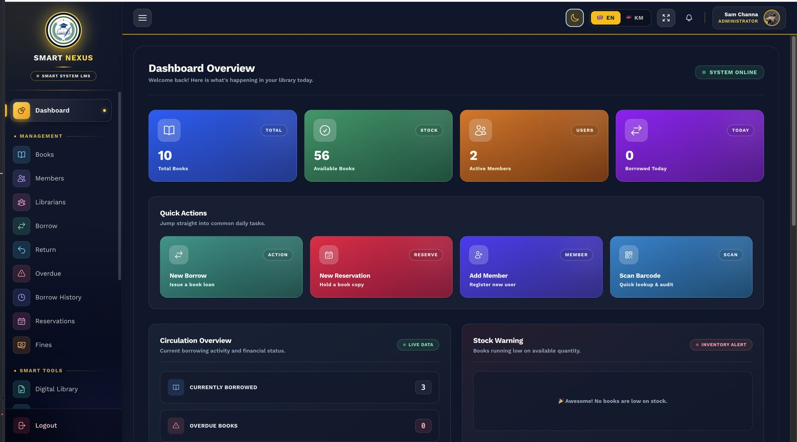
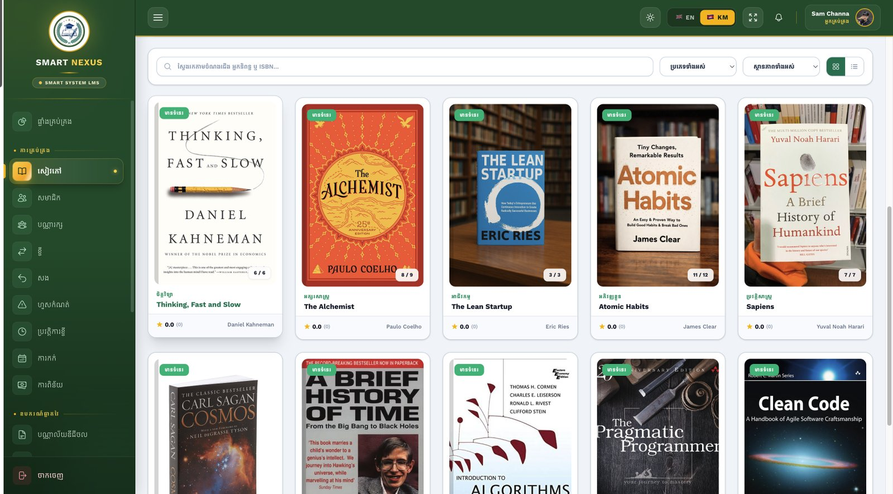
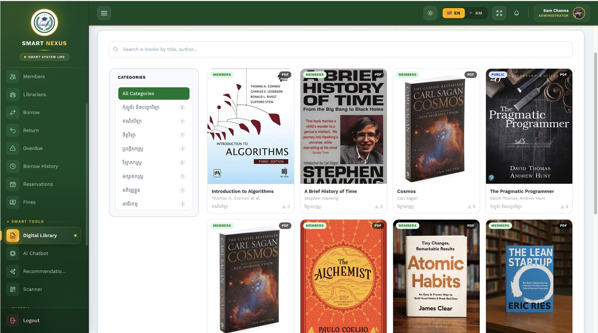
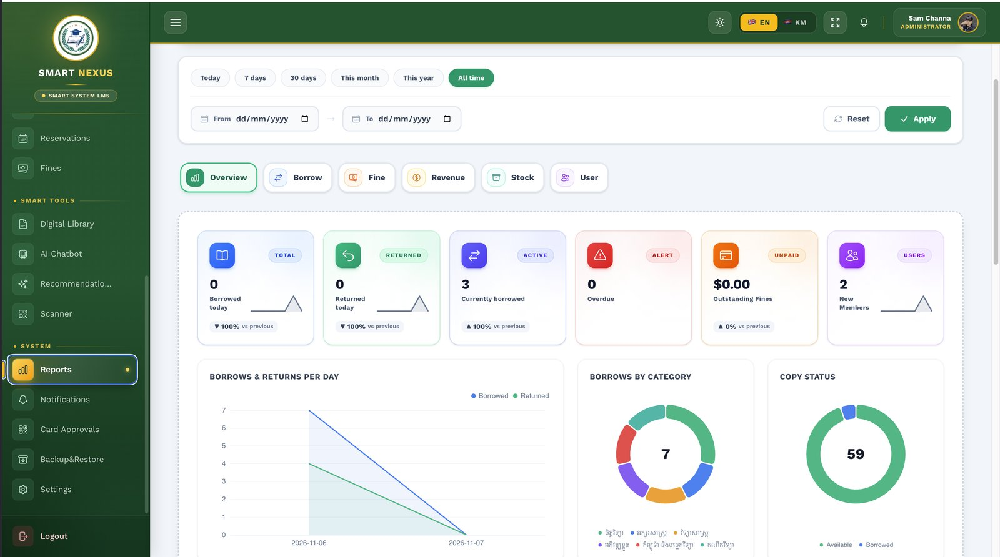
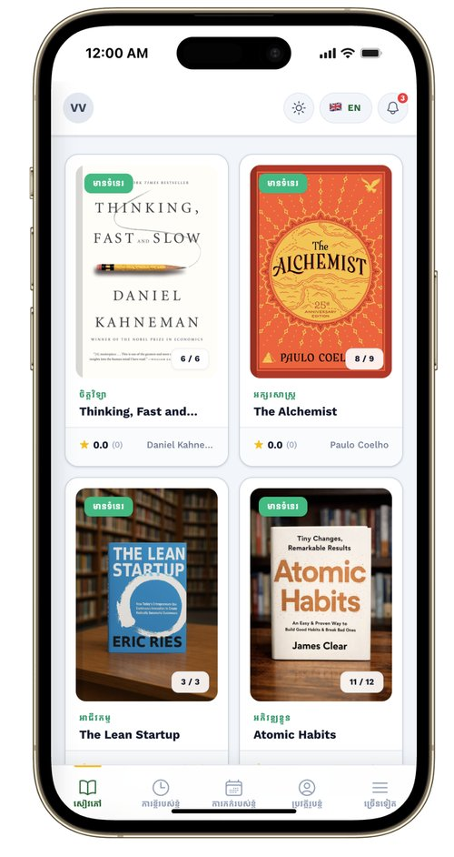
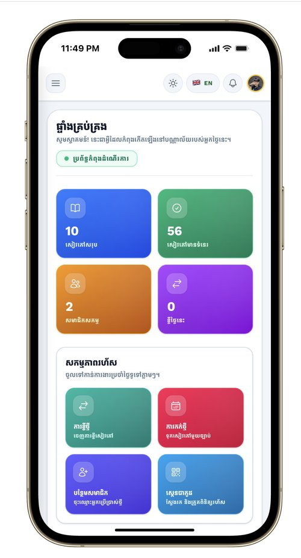

# Smart Nexus LMS: Library Management System (Frontend)

A bilingual (**Khmer / English**) library management system for a university or school library.
Librarians manage books, members, borrowing, reservations and fines. Members find books, reserve them and read e-books online.

Built with **Vue 3**, **Pinia**, **Vue Router** and **Tailwind CSS**. It talks to a Laravel REST API.

- Backend (Laravel API): [Chana758/SYSTEM_LMS_API](https://github.com/Chana758/SYSTEM_LMS_API)



---

## Features

### For librarians and admins
- **Dashboard** with charts for borrowing, stock, members and fines.
- **Catalog:** books, categories and physical copies of each book.
- **Circulation:** borrow and return books, with overdue tracking.
- **Reservations:** a queue per book. When a reservation expires, the next member in line gets the book.
- **Fines** for late returns.
- **Members:** member profiles, membership types and printable **member cards with a QR code**.
- **Scanner:** scan book and member codes with the computer's camera, keep a scan history and run a stocktake.
- **Phone as a scanner:** pair a phone with the desktop using a 6-digit PIN, then scan with the phone camera.
- **Reports** for borrowing, fines, members, stock and revenue, with **PDF and Excel export**.
- **Settings** and **backup / restore** (admin only).

### For members
- Search the catalog, see book details and reviews, and reserve books.
- **Digital library:** read e-books (EPUB) in the browser and save favourites.
- See their own borrows, reservations and fines.
- **AI assistant** that answers questions about the library, and **book recommendations**.

### For everyone
- Khmer and English interface, light and dark mode.
- **Real-time notifications** (Laravel Reverb WebSockets), for example overdue reminders.
- Works on phones as well as desktops, and can be installed as an app (PWA).
- Role-based pages for **admin**, **librarian** and **member**.

---

## Screenshots

| Books (Khmer) | Digital library |
|---|---|
|  |  |

| Reports | Member on mobile | Admin on mobile |
|---|---|---|
|  |  |  |

---

## Tech stack

| Area | Tools |
|---|---|
| UI | Vue 3, Tailwind CSS 4, Heroicons |
| Build | Vite, vite-plugin-pwa |
| State and routing | Pinia, Vue Router |
| Languages | vue-i18n (Khmer, English) |
| HTTP and real time | Axios, Laravel Echo + pusher-js (Reverb) |
| Charts | Chart.js, ECharts |
| Scanning and QR | @zxing/browser, qrcode |
| E-books | epub.js |
| Export | jsPDF (+ autotable), SheetJS (xlsx) |

---

## Project structure

The code is grouped by feature. Each feature has its own pages, components, API services and Pinia store.

```
src/
├── api/              # Axios instance, endpoints, interceptors
├── features/
│   ├── auth/  catalog/  circulation/  reservation/  fines/  members/
│   ├── scanner/  digital-library/  reports/  notifications/  dashboard/
│   └── ai-chatbot/  ai-recommendation/  settings/  staff/
├── layouts/          # AdminLayout, MemberLayout
├── locales/en, km/   # translations
├── middleware/       # route guards: auth, guest, role, demo
├── router/           # one route file per feature
├── stores/           # shared stores: language, theme, branding
└── echo.js           # real-time connection (Reverb)
```

---

## Getting started

### Requirements
- Node.js 20+
- The [Smart Nexus API](https://github.com/Chana758/SYSTEM_LMS_API) running on `http://localhost:8000`, with Reverb on port `8080`

### Install and run

```bash
git clone https://github.com/Chana758/SYSTEM_LMS.git
cd SYSTEM_LMS
npm install
cp .env.example .env
npm run dev          # http://localhost:5173
```

In development, Vite forwards `/api`, `/broadcasting/auth`, `/app` and `/storage` to the Laravel backend and Reverb (see `vite.config.js`).
The comments in `.env.example` explain each variable.

### Scripts

| Command | What it does |
|---|---|
| `npm run dev` | Start the dev server |
| `npm run build` | Build for production into `dist/` |
| `npm run preview` | Preview the production build |

`wrangler.jsonc` serves the built `dist/` folder as a single-page app on Cloudflare.

---

## Author

**Sam Channa**, ITE student at the Royal University of Phnom Penh

- GitHub: [@Chana758](https://github.com/Chana758)
- Email: csam26176@gmail.com
